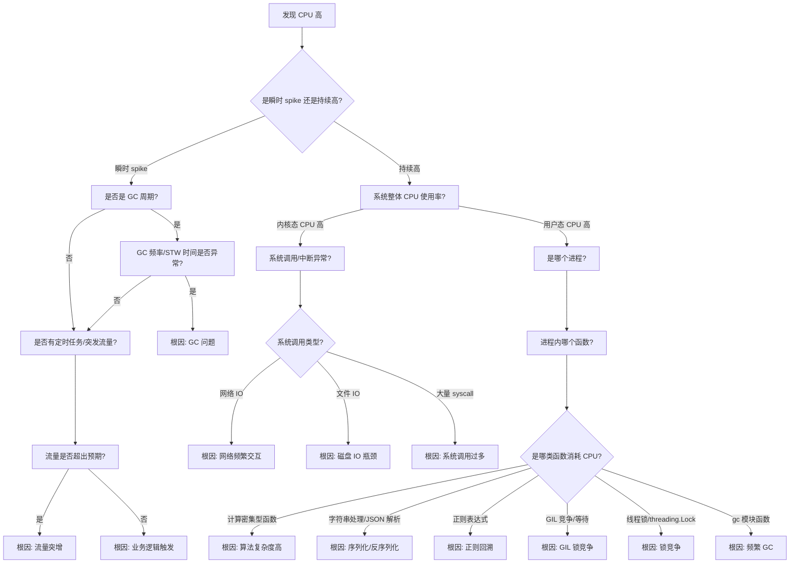

# CPU 高问题诊断决策树（Python 版）

## CPU 高问题诊断全流程



## 诊断步骤详解

### 第一层：问题定性
**看什么指标？**
- CPU 使用率趋势图（1分钟、5分钟、15分钟）
- 区分 user%、sys%、idle%、wa%

**用什么工具？**
- `top` / `htop` - 实时 CPU 使用率
- `mpstat -P ALL 1` - 每核 CPU 使用情况
- Grafana/Prometheus 监控面板
- Windows: 任务管理器、资源监视器

**怎么判断？**
- user% > 70%：用户态代码问题
- sys% > 30%：内核态/系统调用问题
- wa% > 20%：IO 等待导致 CPU 空转

---

### 第二层：定位进程
**看什么指标？**
- 进程 CPU 使用率（%CPU）
- 进程状态（R、D、S）

**用什么工具？**
```bash
# Linux
ps aux --sort=-%cpu | head -10
pidstat -u 1

# Windows PowerShell
Get-Process | Sort-Object CPU -Descending | Select-Object -First 10
```

---

### 第三层：Python 程序内部分析
**看什么指标？**
- 哪个函数占用 CPU 最多
- 函数调用栈
- 每一行代码的执行时间

**用什么工具？**

#### cProfile - 内置性能分析器
```python
# 方式1: 命令行运行
python -m cProfile -o profile.stats my_script.py

# 方式2: 代码中嵌入
import cProfile

def main():
    # 你的业务代码
    pass

if __name__ == "__main__":
    profiler = cProfile.Profile()
    profiler.enable()
    main()
    profiler.disable()
    profiler.dump_stats("profile.stats")

# 分析结果
import pstats
stats = pstats.Stats("profile.stats")
stats.sort_stats(pstats.SortKey.TIME)
stats.print_stats(20)  # 打印前 20 个耗时最长的函数
```

#### py-spy - 非侵入式采样分析（推荐生产环境）
```bash
# 安装
pip install py-spy

# 实时查看 CPU 占用（类似 top）
py-spy top --pid 12345

# 生成火焰图
py-spy record -o profile.svg --pid 12345 --duration 30

# 生成调用图
py-spy record -f speedscope -o profile.json --pid 12345
```

#### line_profiler - 行级性能分析
```python
# 安装
pip install line_profiler

# 代码中使用装饰器
from line_profiler import profile

@profile
def my_function():
    # 需要分析的代码
    result = []
    for i in range(1000000):
        result.append(i * 2)
    return result

# 运行分析
kernprof -l -v my_script.py
```

#### pyinstrument - 统计采样分析器
```bash
# 安装
pip install pyinstrument

# 运行分析
pyinstrument my_script.py

# 生成 HTML 报告
pyinstrument --renderer html -o profile.html my_script.py

# 附加到运行中的进程
pyinstrument --pid 12345
```

---

## 根因定位 & 常见解决方案

| 根因分类 | 典型特征 | 检测方法 | 解决方案 |
|---------|---------|---------|---------|
| **算法复杂度高** | 嵌套循环、递归、O(n²) 算法 | cProfile 看函数调用次数和时间 | 1. 优化算法复杂度<br>2. 增加缓存<br>3. 分批处理 |
| **序列化/反序列化** | json.dumps/loads、pickle 占比高 | py-spy 火焰图看热点 | 1. 使用更快的序列化库（ujson、orjson）<br>2. 避免重复序列化<br>3. 减少序列化字段 |
| **正则表达式** | re.compile、re.match 占比高 | line_profiler 定位正则代码 | 1. 避免贪婪匹配 `.*`<br>2. 预编译正则 `re.compile()`<br>3. 考虑字符串替换 |
| **GIL 锁竞争** | 多线程 CPU 无法打满<br>多核利用率低 | py-spy 观察 `take_gil` 函数 | 1. 使用多进程（multiprocessing）<br>2. 使用 C 扩展（numpy、pandas）<br>3. 使用 asyncio 异步编程 |
| **频繁 GC** | gc.collect、gc 模块函数占比高 | gc 模块监控<br>`gc.set_debug(gc.DEBUG_STATS)` | 1. 减少对象分配<br>2. 禁用自动 GC 手动控制<br>3. 使用 `__slots__` 减少内存开销 |
| **线程锁竞争** | threading.Lock.acquire 占比高 | py-spy 火焰图<br>tracemalloc | 1. 减小锁粒度<br>2. 使用 multiprocessing 替代<br>3. 使用无锁数据结构 |
| **网络频繁交互** | socket.send/recv 占比高 | 网络抓包<br>链路追踪 | 1. 连接池复用<br>2. 批量请求<br>3. 异步处理 |
| **流量突增** | QPS 曲线与 CPU 曲线同步 | 监控系统 | 1. 扩容<br>2. 限流降级<br>3. 缓存优化 |

## Python 特有问题

### 1. GIL（全局解释器锁）问题
**问题特征**：
- 多线程程序 CPU 使用率始终在 100% 左右（单核心）
- 增加线程数量不能提升性能
- py-spy 显示 `take_gil` 函数占比较高

**解决方案**：
```python
# ❌ 错误：CPU 密集型任务用多线程
import threading

def cpu_bound_task():
    result = 0
    for i in range(10_000_000):
        result += i
    return result

threads = [threading.Thread(target=cpu_bound_task) for _ in range(4)]
for t in threads:
    t.start()  # GIL 限制，只能用一个核心

# ✅ 正确：使用多进程
import multiprocessing

processes = [multiprocessing.Process(target=cpu_bound_task) for _ in range(4)]
for p in processes:
    p.start()  # 可以利用多核

# ✅ 正确：使用 numpy 等 C 扩展（释放 GIL）
import numpy as np

def fast_calculation():
    arr = np.arange(10_000_000)  # numpy 内部释放 GIL
    return arr.sum()
```

### 2. 正则表达式回溯问题
**问题特征**：
- 特定输入下 CPU 飙升
- re 相关函数占用大量 CPU

**解决方案**：
```python
# ❌ 错误：贪婪匹配可能导致灾难性回溯
import re
pattern = re.compile(r'(a+)+b')  # 危险模式
pattern.match('aaaaaaaaaaaaaaaaaaaaaaaaaaaaaaaaaaaaaac')

# ✅ 正确：优化正则表达式
pattern = re.compile(r'a+b')  # 简化

# ✅ 正确：使用非贪婪匹配
pattern = re.compile(r'a+?b')

# ✅ 正确：预编译正则（多次使用时）
pattern = re.compile(r'pattern')  # 只编译一次
for _ in range(1000):
    pattern.match(text)
```

### 3. 序列化性能问题
**问题特征**：
- json.dumps/loads 占用大量 CPU
- 大数据量序列化时延迟高

**解决方案**：
```python
# ❌ 较慢的标准 json
import json
data = {"key": "value" * 1000}
json.dumps(data)

# ✅ 更快的 orjson（推荐）
import orjson
orjson.dumps(data)  # 比标准 json 快 10-20 倍

# ✅ 只序列化必要的字段
def to_dict(self):
    return {
        'id': self.id,
        'name': self.name,  # 只序列化需要的字段
        # 排除大对象
    }
```

## 快速检查清单

1. ✅ 用 `top`/任务管理器确认是 user 还是 sys CPU 高
2. ✅ 确认 Python 进程是否只使用了单核（GIL 问题）
3. ✅ 用 py-spy 采样 30s，生成火焰图
4. ✅ 用 cProfile 分析函数级 CPU 占用
5. ✅ 检查是否有大量正则表达式匹配
6. ✅ 检查序列化/反序列化是否是热点
7. ✅ 检查 GC 频率（`gc.get_stats()`）
8. ✅ 检查线程数量和锁竞争情况
9. ✅ 确认是否是 CPU 密集型任务用了多线程
10. ✅ 检查是否有无限循环或死循环
