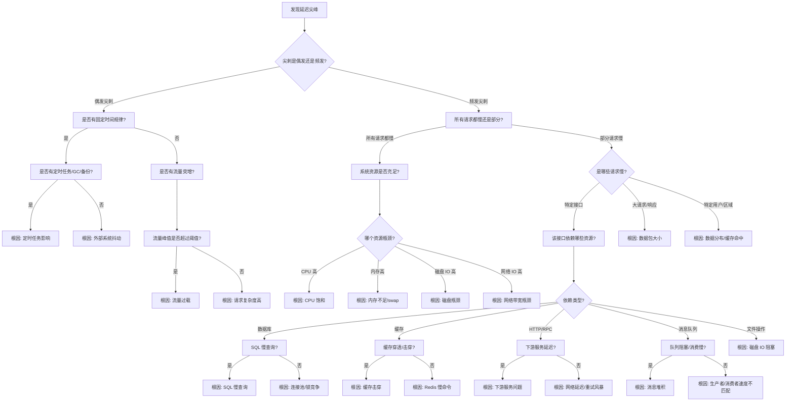

# 延迟尖峰问题诊断决策树（Python 版）

## 延迟尖峰诊断全流程



## 诊断步骤详解

### 第一层：问题定性
**看什么指标？**
- P50、P95、P99 延迟曲线
- 延迟分布直方图
- 错误率、超时率
- 请求量 QPS 曲线

**用什么工具？**
- Grafana/Prometheus 延迟监控
- APM 系统（New Relic、Datadog、SkyWalking）
- 日志系统（ELK、Loki）
- `curl -w` 单请求时延分解

**怎么判断？**
- P99 尖刺但 P50 正常：尾部延迟问题
- 所有百分位都高：系统性问题
- 特定时间段尖刺：定时任务/调度问题
- 与流量正相关：资源饱和问题

---

### 第二层：请求分类
**看什么指标？**
- 按接口、HTTP method、状态码分组的延迟
- 按用户、租户、区域分组的延迟
- 请求大小与延迟的关系

**用什么工具？**

#### cProfile + 装饰器
```python
import time
import functools
import cProfile
import pstats

def latency_profile(func):
    @functools.wraps(func)
    def wrapper(*args, **kwargs):
        pr = cProfile.Profile()
        pr.enable()
        start = time.time()
        result = func(*args, **kwargs)
        duration = time.time() - start
        
        if duration > 1.0:  # 只记录慢请求
            pr.disable()
            ps = pstats.Stats(pr).sort_stats(pstats.SortKey.TIME)
            print(f"\nSlow request {func.__name__}: {duration:.2f}s")
            ps.print_stats(10)
        
        return result
    return wrapper
```

#### py-spy 火焰图（非侵入式）
```bash
# 记录 30 秒，采样率 100Hz
py-spy record -o flamegraph.svg --pid 12345 --duration 30 --rate 100

# 实时查看调用栈
py-spy top --pid 12345
```

#### 链路追踪（OpenTelemetry）
```python
from opentelemetry import trace
from opentelemetry.sdk.trace import TracerProvider
from opentelemetry.sdk.trace.export import BatchSpanProcessor
from opentelemetry.exporter.jaeger.thrift import JaegerExporter

# 配置 Jaeger 导出
jaeger_exporter = JaegerExporter(
    agent_host_name="localhost",
    agent_port=6831,
)

# 设置全局追踪器
provider = TracerProvider()
processor = BatchSpanProcessor(jaeger_exporter)
provider.add_span_processor(processor)
trace.set_tracer_provider(provider)

# 使用装饰器追踪
tracer = trace.get_tracer(__name__)

def trace_func(func):
    @functools.wraps(func)
    def wrapper(*args, **kwargs):
        with tracer.start_as_current_span(func.__name__) as span:
            start = time.time()
            result = func(*args, **kwargs)
            duration = time.time() - start
            span.set_attribute("duration", duration)
            return result
    return wrapper
```

---

### 第三层：时延分解
**看什么指标？**
- DNS 时间、TCP 连接时间、TLS 握手时间
- 服务端处理时间、响应传输时间
- 调用链各阶段耗时
- 等待时间（锁、连接池、队列）

**用什么工具？**

#### curl 时延分解
```bash
curl -w "
DNS: %{time_namelookup}s
Connect: %{time_connect}s
TLS: %{time_appconnect}s
TTFB: %{time_starttransfer}s
Total: %{time_total}s
Size: %{size_download} bytes
" -o /dev/null -s "http://example.com/api"
```

#### Python 代码时延打点
```python
import time
from contextlib import contextmanager

@contextmanager
def timer(name):
    start = time.time()
    yield
    duration = time.time() - start
    if duration > 0.1:  # 只记录超过 100ms 的
        print(f"{name}: {duration*1000:.2f}ms")

# 使用示例
def process_request():
    with timer("db_query"):
        result = db.query("SELECT * FROM ...")
    
    with timer("data_process"):
        processed = process_data(result)
    
    with timer("serialize"):
        json.dumps(processed)
```

#### asyncio 事件循环监控
```python
import asyncio
import time

async def monitor_loop_lag():
    """监控事件循环延迟"""
    while True:
        start = time.time()
        await asyncio.sleep(0.1)  # 期望 100ms 后唤醒
        lag = (time.time() - start - 0.1) * 1000
        if lag > 10:  # 超过 10ms 告警
            print(f"Event loop lag: {lag:.2f}ms")
        await asyncio.sleep(1)
```

---

## 根因定位 & 常见解决方案

| 根因分类 | 典型特征 | 检测方法 | 解决方案 |
|---------|---------|---------|---------|
| **GC 停顿** | 尖刺周期性出现<br>与对象创建速率正相关 | `gc.set_debug(gc.DEBUG_STATS)`<br>观察 gc 时间点 | 1. 减少对象分配<br>2. 调大 GC 阈值<br>3. 手动控制 GC 时机<br>4. 使用 `gc.freeze()` |
| **GIL 竞争** | 多线程 CPU 利用率低<br>`take_gil` 占比高 | py-spy 火焰图<br>系统调用分析 | 1. 使用多进程<br>2. 使用 C 扩展<br>3. 使用 asyncio 异步<br>4. 减少线程数量 |
| **事件循环阻塞** | asyncio 任务全部变慢<br>事件循环延迟高 | `monitor_loop_lag()`<br>py-spy 看调用栈 | 1. 避免 CPU 密集型任务<br>2. 使用 `run_in_executor`<br>3. 拆分长任务<br>4. 定期 `await asyncio.sleep(0)` |
| **数据库慢查询** | 数据库 CPU/IO 高<br>特定 SQL 执行时间长 | 数据库慢查询日志<br>EXPLAIN 分析 | 1. 添加索引<br>2. 优化 SQL<br>3. 读写分离<br>4. 增加缓存 |
| **连接池耗尽** | 请求等待连接时间长<br>连接数达到上限 | 连接池监控<br>日志分析 | 1. 调大连接池<br>2. 缩短空闲超时<br>3. 限流<br>4. 检查连接泄漏 |
| **缓存击穿** | 热点 key 过期时尖刺<br>数据库流量突增 | Redis 慢日志<br>缓存命中率 | 1. 热点 key 永不过期<br>2. 互斥锁重建<br>3. 预热热点数据<br>4. 随机过期时间 |
| **下游服务慢** | 调用链显示 RPC 占比高<br>下游延迟高 | 链路追踪<br>下游监控 | 1. 异步调用<br>2. 熔断降级<br>3. 增加缓存<br>4. 下游优化 |
| **网络延迟** | TCP 重传率高<br>跨机房调用慢 | ping/traceroute<br>tcpdump | 1. 同机房部署<br>2. 连接池复用<br>3. 批量请求<br>4. 压缩传输 |
| **锁竞争** | 多线程等待锁时间长<br>串行化执行 | py-spy 火焰图<br>打点计时 | 1. 减小锁粒度<br>2. 使用读写锁<br>3. 无锁数据结构<br>4. 减少持有时间 |
| **重试风暴** | 重试次数激增<br>放大效应明显 | 重试指标<br>错误率监控 | 1. 指数退避<br>2. 重试次数上限<br>3. 熔断保护<br>4. 幂等保证 |

## Python 特有延迟问题

### 1. GC 停顿问题
**问题特征**：
- 定期出现延迟尖刺（几秒到几十秒一次）
- 尖刺时间与对象分配速率正相关
- 尖刺期间所有请求都变慢

**解决方案**：
```python
import gc
import time

# ❌ 默认 GC，可能在请求处理时触发
# gc.enable()  # 默认开启

# ✅ 方案1：调整 GC 阈值
gc.set_threshold(10000, 10, 5)  # 提高触发阈值

# ✅ 方案2：手动控制 GC 时机
gc.disable()  # 禁用自动 GC

def handle_request():
    try:
        # 处理请求
        return response
    finally:
        # 请求结束后再 GC
        if should_collect_gc():
            gc.collect()

# ✅ 方案3：闲时 GC
import threading

def gc_background():
    while True:
        time.sleep(60)  # 每分钟检查一次
        if is_system_idle():
            gc.collect()

threading.Thread(target=gc_background, daemon=True).start()

# ✅ 方案4：冻结长期存活对象
def freeze_long_lived_objects():
    """将长期存活对象移动到第2代，减少 GC 扫描"""
    gc.collect()  # 先清理一次
    gc.freeze()   # 冻结当前所有对象
```

### 2. asyncio 事件循环阻塞
**问题特征**：
- 所有异步任务同时变慢
- 事件循环延迟（loop lag）很高
- CPU 不一定高

**解决方案**：
```python
import asyncio
import time

# ❌ 错误：在协程中执行 CPU 密集型任务
async def bad_handler():
    result = cpu_intensive_task()  # 阻塞事件循环
    return result

# ✅ 正确：将 CPU 任务放到线程池
def cpu_intensive_task():
    # 计算密集型代码
    time.sleep(1)  # 模拟计算
    return "done"

async def good_handler():
    loop = asyncio.get_running_loop()
    result = await loop.run_in_executor(None, cpu_intensive_task)
    return result

# ✅ 正确：拆分长任务
async def long_task():
    for i in range(100):
        # 每次处理一小部分
        process_chunk(i)
        await asyncio.sleep(0)  # 让出事件循环

# ✅ 正确：监控事件循环延迟
async def monitor_loop():
    while True:
        t0 = time.time()
        await asyncio.sleep(0.01)  # 期望 10ms
        lag = (time.time() - t0 - 0.01) * 1000
        if lag > 50:  # 超过 50ms 告警
            print(f"Warning: event loop lag {lag:.1f}ms")
        await asyncio.sleep(1)
```

### 3. 数据库连接池问题
**问题特征**：
- 高并发下延迟突然升高
- 日志显示 "获取连接超时"
- 数据库负载不高

**解决方案**：
```python
# ❌ 错误：连接池太小
import psycopg2.pool

pool = psycopg2.pool.SimpleConnectionPool(
    minconn=1,
    maxconn=5,  # 太小，高并发下不够用
    database="mydb"
)

# ✅ 正确：合理配置连接池
pool = psycopg2.pool.SimpleConnectionPool(
    minconn=10,
    maxconn=50,  # 根据并发量调整
    database="mydb"
)

# ✅ 正确：使用带超时的连接获取
import contextlib

@contextlib.contextmanager
def get_connection():
    try:
        conn = pool.getconn(timeout=5.0)  # 设置超时
        yield conn
    finally:
        pool.putconn(conn)

# ✅ 正确：监控连接池状态
def monitor_pool():
    while True:
        used = len(pool._used)
        free = len(pool._pool)
        print(f"Pool: used={used}, free={free}")
        if free == 0:
            print("Warning: connection pool exhausted!")
        time.sleep(10)
```

### 4. 日志同步写入延迟
**问题特征**：
- 高并发下延迟抖动
- 磁盘 IO 很高
- 与日志量正相关

**解决方案**：
```python
import logging
import queue
import atexit

# ❌ 错误：同步写入文件
logging.basicConfig(
    filename="app.log",
    level=logging.INFO,
    format="%(message)s"
)

# ✅ 正确：异步日志队列
class AsyncLogHandler(logging.Handler):
    def __init__(self, base_handler):
        super().__init__()
        self.base_handler = base_handler
        self.queue = queue.Queue(maxsize=10000)
        self.worker = threading.Thread(target=self._process, daemon=True)
        self.worker.start()
        atexit.register(self._shutdown)
    
    def emit(self, record):
        try:
            self.queue.put_nowait(record)
        except queue.Full:
            pass  # 队列满时丢弃，避免阻塞
    
    def _process(self):
        while True:
            record = self.queue.get()
            if record is None:
                break
            self.base_handler.emit(record)
    
    def _shutdown(self):
        self.queue.put(None)
        self.worker.join()

# 配置异步日志
file_handler = logging.FileHandler("app.log")
async_handler = AsyncLogHandler(file_handler)
logging.basicConfig(handlers=[async_handler], level=logging.INFO)

# ✅ 正确：批量日志刷新
import logging.handlers

handler = logging.handlers.MemoryHandler(
    capacity=1000,  # 缓存 1000 条
    flushLevel=logging.ERROR,  # ERROR 立即刷新
    target=file_handler
)
```

### 5. 序列化/反序列化延迟
**问题特征**：
- 大请求/响应延迟高
- json.dumps/loads 耗时久
- CPU 占用高

**解决方案**：
```python
import json

# ❌ 错误：使用标准 json 处理大对象
def bad_handler():
    big_data = {"data": [{"id": i} for i in range(10000)]}
    return json.dumps(big_data)  # 慢

# ✅ 正确：使用更快的序列化库
import orjson

def fast_handler():
    big_data = {"data": [{"id": i} for i in range(10000)]}
    return orjson.dumps(big_data)  # 快 10-20 倍

# ✅ 正确：流式序列化，减少内存
def stream_json(items):
    yield '{"data": ['
    first = True
    for item in items:
        if not first:
            yield ","
        yield json.dumps(item)
        first = False
    yield "]}"

# ✅ 正确：只返回需要的字段
def get_user(user_id):
    user = db.get_user(user_id)
    return {
        "id": user.id,
        "name": user.name,
        # 不返回大字段：avatar, bio, etc.
    }
```

## 快速检查清单

1. ✅ 看 P50/P95/P99 延迟曲线，确定尖刺模式
2. ✅ 检查同期 CPU、内存、IO、网络指标
3. ✅ 检查 GC 时间点和停顿时间（`gc.DEBUG_STATS`）
4. ✅ 用 py-spy 生成火焰图，找热点函数
5. ✅ 检查事件循环延迟（asyncio 应用）
6. ✅ 查看链路追踪，找慢请求的耗时分布
7. ✅ 检查数据库慢查询日志、Redis 慢日志
8. ✅ 检查下游服务延迟、错误率
9. ✅ 检查连接池状态（是否耗尽）
10. ✅ 检查是否有定时任务在尖刺时间运行
11. ✅ 检查序列化/反序列化是否是瓶颈
12. ✅ 检查日志写入是否阻塞
13. ✅ 检查锁竞争情况
14. ✅ tcpdump 抓包看网络延迟
