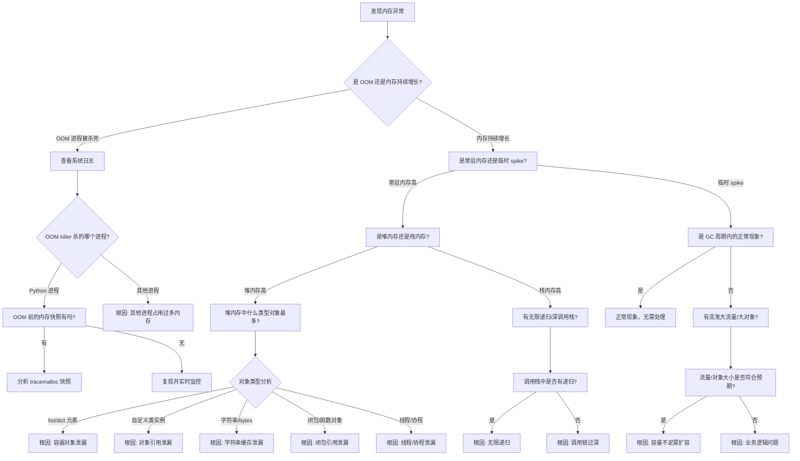

# 内存泄漏/OOM 问题诊断决策树（Python 版）

## 内存泄漏/OOM 诊断全流程



## 诊断步骤详解

### 第一层：问题定性
**看什么指标？**
- 内存使用率趋势（RSS、VIRT）
- 进程内存 vs 系统内存
- 是否有 OOM kill 日志

**用什么工具？**
```bash
# Linux
dmesg | grep -i oom  # 查看 OOM 日志
free -h  # 系统整体内存
top / htop  # 进程内存（RES 列）

# Windows PowerShell
Get-EventLog -LogName System -Newest 100 | Where-Object {$_.EventID -eq 2004}
```
- Grafana/Prometheus 内存监控
- Windows: 任务管理器、资源监视器

**怎么判断？**
- RES 持续增长不下降：内存泄漏
- 突然 OOM kill：大对象/突发流量
- 系统内存耗尽：可能是其他进程问题

---

### 第二层：Python 内存分布
**看什么指标？**
- 堆内存分配统计
- 对象类型分布
- 对象引用链
- 垃圾回收统计

**用什么工具？**

#### tracemalloc - 内置内存追踪器（Python 3.4+）
```python
import tracemalloc

# 启动追踪
tracemalloc.start()

# 获取当前内存快照
snapshot = tracemalloc.take_snapshot()

# 查看内存占用前 10 的位置
top_stats = snapshot.statistics('lineno')
for stat in top_stats[:10]:
    print(stat)

# 对比两个时间点的差异
snapshot1 = tracemalloc.take_snapshot()
# ... 运行业务代码 ...
snapshot2 = tracemalloc.take_snapshot()
top_stats = snapshot2.compare_to(snapshot1, 'lineno')
for stat in top_stats[:10]:
    print(stat)

# 跟踪内存分配
tracemalloc.clear_traces()
current, peak = tracemalloc.get_traced_memory()
print(f"Current: {current / 1024 / 1024:.2f} MB")
print(f"Peak: {peak / 1024 / 1024:.2f} MB")
```

#### objgraph - 对象引用关系分析
```bash
# 安装
pip install objgraph
```

```python
import objgraph

# 查看对象数量最多的类型
objgraph.show_most_common_types(limit=20)

# 查看增长最多的对象
objgraph.show_growth(limit=10)

# 查看特定对象的引用链
objgraph.show_chain(
    objgraph.find_backref_chain(
        objgraph.by_type('MyClass')[0],
        objgraph.is_proper_module
    ),
    filename='chain.png'
)

# 查找泄漏的对象
roots = objgraph.get_leaking_objects()
print(f"Leaking objects: {len(roots)}")
```

#### memory_profiler - 行级内存分析
```bash
# 安装
pip install memory_profiler
```

```python
from memory_profiler import profile

@profile
def my_function():
    a = [1] * (10 ** 6)
    b = [2] * (2 * 10 ** 7)
    del b
    return a

# 运行分析
# python -m memory_profiler script.py
```

#### pympler - 内存分析工具集
```bash
# 安装
pip install pympler
```

```python
from pympler import asizeof, tracker, summary

# 计算对象实际大小
print(asizeof.asizeof(my_object))  # 比 sys.getsizeof 更准确

# 追踪内存变化
tr = tracker.SummaryTracker()
tr.print_diff()  # 打印前后差异

# 生成内存摘要
sum = summary.summarize(muppy.get_objects())
summary.print_(sum)
```

#### gc 模块 - 垃圾回收监控
```python
import gc

# 启用调试
gc.set_debug(gc.DEBUG_STATS | gc.DEBUG_LEAK)

# 手动触发 GC
gc.collect()

# 查看各代对象数量
print(gc.get_count())  # (第0代, 第1代, 第2代)

# 查看无法回收的对象
gc.garbage  # 循环引用无法回收的对象列表

# 禁用自动 GC（性能敏感场景）
gc.disable()
```

---

### 第三层：定位泄漏源
**看什么指标？**
- 哪类对象增长最快
- 哪个位置分配的内存最多
- 对象引用链

**用什么工具？**
```python
# tracemalloc 定位具体代码行
snapshot = tracemalloc.take_snapshot()
for stat in snapshot.statistics('traceback')[:5]:
    print(f"{stat.size / 1024 / 1024:.2f} MB")
    for line in stat.traceback.format():
        print(line)
    print()

# objgraph 找引用链
import objgraph
objgraph.show_refs([my_obj], filename='refs.png')  # 显示引用了谁
objgraph.show_backrefs([my_obj], filename='backrefs.png')  # 显示被谁引用
```

---

## 根因定位 & 常见解决方案

| 根因分类 | 典型特征 | 检测方法 | 解决方案 |
|---------|---------|---------|---------|
| **全局缓存泄漏** | dict/list 持续增长<br>只加不删 | objgraph.show_growth()<br>tracemalloc 看热点 | 1. 设置缓存容量上限<br>2. 使用 LRU 缓存<br>3. 定期清理过期 key |
| **闭包引用泄漏** | 闭包捕获了大对象<br>函数对象不释放 | objgraph 看 function 类型数量 | 1. 避免捕获大对象<br>2. 显式删除引用 `del`<br>3. 使用 `weakref` 弱引用 |
| **线程泄漏** | 线程数量持续增长<br>threading.Thread 对象不释放 | `threading.enumerate()`<br>objgraph 看 Thread 类型 | 1. 确保线程正常退出<br>2. 使用线程池<br>3. 设置 daemon 线程 |
| **循环引用** | 对象互相引用<br>gc.garbage 中有对象 | gc.garbage 列表<br>objgraph.find_backref_chain | 1. 手动打破循环引用<br>2. 使用 weakref<br>3. 避免 `__del__` 方法 |
| **大对象泄漏** | list/bytes 对象特别大<br>内存增长与请求量正相关 | tracemalloc 找分配点<br>pympler.asizeof | 1. 使用生成器替代列表<br>2. 及时 `del` + gc.collect()<br>3. 使用内存映射文件 |
| **__del__ 方法** | 有析构函数的对象无法回收<br>gc 无法处理循环引用 | objgraph 看 `__del__` 方法的类 | 1. 移除 `__del__` 方法<br>2. 使用 context manager 替代 |
| **第三方库泄漏** | 特定库函数调用后内存不释放 | 对比调用前后内存快照 | 1. 升级库版本<br>2. 寻找替代库<br>3. 手动释放资源 |
| **日志/调试代码** | 日志记录保存了过多上下文<br>debug 模式内存泄漏 | 检查日志配置<br>对比 debug/release 模式 | 1. 控制日志级别<br>2. 生产关闭 debug 模式<br>3. 定期清理日志缓冲区 |

## Python 内存泄漏常见模式

### 1. 全局缓存泄漏
```python
# ❌ 错误：只加不删，无限增长
global_cache = {}

def add_to_cache(key, value):
    global_cache[key] = value  # 永远不删除

# ✅ 正确：使用 LRU 缓存
from functools import lru_cache

@lru_cache(maxsize=1000)  # 限制缓存大小
def get_data(key):
    return expensive_query(key)

# ✅ 正确：使用弱引用字典
import weakref
weak_cache = weakref.WeakKeyDictionary()  # key 不再被引用时自动清理

# ✅ 正确：带过期时间的缓存
import time
from collections import OrderedDict

class ExpiringCache:
    def __init__(self, max_size=1000, ttl=3600):
        self.cache = OrderedDict()
        self.max_size = max_size
        self.ttl = ttl
    
    def get(self, key):
        if key in self.cache:
            value, timestamp = self.cache[key]
            if time.time() - timestamp < self.ttl:
                self.cache.move_to_end(key)
                return value
            del self.cache[key]
        return None
    
    def set(self, key, value):
        if len(self.cache) >= self.max_size:
            self.cache.popitem(last=False)  # FIFO 淘汰
        self.cache[key] = (value, time.time())
```

### 2. 闭包引用泄漏
```python
# ❌ 错误：闭包捕获了大对象，无法释放
def create_handler():
    big_data = [1] * 10_000_000  # 80MB 数据
    
    def handler():
        return len(big_data)  # 闭包引用了 big_data
    
    # handler 返回后，big_data 仍然被持有
    return handler

# ✅ 正确：只捕获需要的数据
def create_handler():
    big_data = [1] * 10_000_000
    result = len(big_data)
    del big_data  # 显式删除
    
    def handler():
        return result  # 只引用结果
    
    return handler

# ✅ 正确：使用 weakref 弱引用
import weakref

class BigObject:
    pass

def create_handler(obj):
    weak_obj = weakref.ref(obj)  # 弱引用
    
    def handler():
        actual_obj = weak_obj()
        if actual_obj:  # 对象可能已被回收
            return actual_obj.value
        return None
    
    return handler
```

### 3. 线程泄漏
```python
# ❌ 错误：线程没有退出条件
import threading
import time

def worker():
    while True:  # 无限循环
        time.sleep(1)

for _ in range(100):
    t = threading.Thread(target=worker)
    t.start()  # 100 个线程永远运行

# ✅ 正确：使用退出标志
def worker(stop_event):
    while not stop_event.is_set():  # 检查退出标志
        time.sleep(1)

stop_event = threading.Event()
t = threading.Thread(target=worker, args=(stop_event,))
t.start()

# 需要停止时
stop_event.set()
t.join()

# ✅ 正确：使用线程池
from concurrent.futures import ThreadPoolExecutor

with ThreadPoolExecutor(max_workers=10) as executor:
    for _ in range(100):
        executor.submit(task)  # 线程自动复用和回收
```

### 4. 循环引用 + __del__
```python
# ❌ 错误：循环引用 + __del__ 方法导致无法回收
class Node:
    def __init__(self):
        self.next = None
    
    def __del__(self):  # 析构函数导致问题
        pass

a = Node()
b = Node()
a.next = b
b.next = a  # 循环引用
del a
del b
# gc 无法回收这两个对象，会进入 gc.garbage

# ✅ 正确：移除 __del__ 方法
class Node:
    def __init__(self):
        self.next = None

# ✅ 正确：手动打破循环引用
a.next = None
b.next = None
del a
del b

# ✅ 正确：使用 weakref
import weakref

class Node:
    def __init__(self):
        self._next = None
    
    @property
    def next(self):
        return self._next() if self._next else None
    
    @next.setter
    def next(self, value):
        self._next = weakref.ref(value) if value else None
```

### 5. 生成器/协程泄漏
```python
# ❌ 错误：生成器没有迭代完
def generator():
    big_data = [1] * 10_000_000
    yield len(big_data)

g = generator()
next(g)  # 只取一次，生成器暂停持有 big_data
# g 被丢弃前不会释放

# ✅ 正确：确保生成器正常结束
g = generator()
try:
    next(g)
except StopIteration:
    pass
finally:
    g.close()  # 显式关闭

# ✅ 正确：使用上下文管理器
from contextlib import contextmanager

@contextmanager
def temp_resource():
    resource = allocate_big_resource()
    try:
        yield resource
    finally:
        free_resource(resource)  # 确保释放
```

## 快速检查清单

1. ✅ `dmesg`/事件查看器确认是否 OOM kill
2. ✅ `top`/任务管理器确认哪个进程内存高
3. ✅ `tracemalloc.start()` 启动内存追踪
4. ✅ `tracemalloc.take_snapshot()` 对比前后内存差异
5. ✅ `objgraph.show_growth()` 看增长最快的对象类型
6. ✅ `objgraph.show_backrefs()` 找对象引用链
7. ✅ `gc.garbage` 检查是否有无法回收的对象
8. ✅ `threading.enumerate()` 检查线程数量
9. ✅ `len(asyncio.all_tasks())` 检查协程任务数量
10. ✅ 检查是否有全局字典/列表无限增长
11. ✅ 检查闭包是否捕获了大对象
12. ✅ 检查是否有 `__del__` 方法导致循环引用
