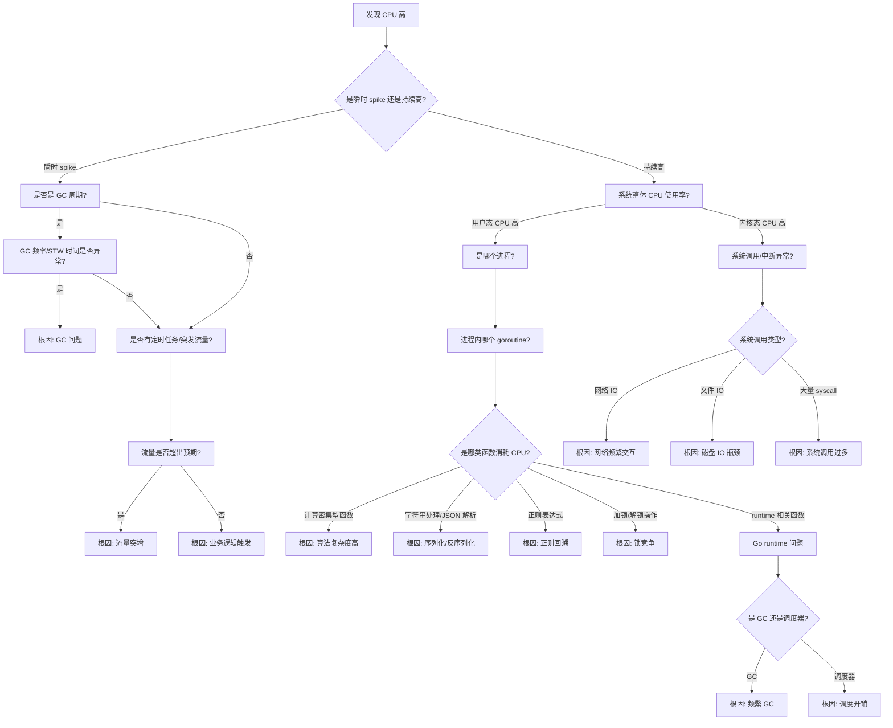

# CPU 高问题诊断决策树

## CPU 高问题诊断全流程



## 诊断步骤详解

### 第一层：问题定性
**看什么指标？**
- CPU 使用率趋势图（1分钟、5分钟、15分钟）
- 区分 user%、sys%、idle%、wa%

**用什么工具？**
- `top` / `htop` - 实时 CPU 使用率
- `mpstat -P ALL 1` - 每核 CPU 使用情况
- Grafana/Prometheus 监控面板

**怎么判断？**
- user% > 70%：用户态代码问题
- sys% > 30%：内核态/系统调用问题
- wa% > 20%：IO 等待导致 CPU 空转

---

### 第二层：定位进程
**看什么指标？**
- 进程 CPU 使用率（%CPU）
- 进程状态（R、D、S）

**用什么工具？**
- `ps aux --sort=-%cpu | head -10` - CPU 最高的 10 个进程
- `pidstat -u 1` - 进程 CPU 使用统计

---

### 第三层：Go 程序内部分析
**看什么指标？**
- 哪个函数占用 CPU 最多
- 函数调用栈
- 火焰图

**用什么工具？**
```bash
# 实时 profiling
go tool pprof -http=:8080 http://localhost:6060/debug/pprof/profile?seconds=30

# 采样完成后分析
top10 - 查看 CPU 占用前 10 的函数
list <函数名> - 查看函数内代码行级 CPU 占用
web - 生成调用图
flame_graph - 生成火焰图
```

---

## 根因定位 & 常见解决方案

| 根因分类 | 典型特征 | 解决方案 |
|---------|---------|---------|
| **算法复杂度高** | 嵌套循环、递归、O(n²) 算法 | 优化算法、增加缓存、分批处理 |
| **序列化/反序列化** | encoding/json、protobuf 函数占比高 | 1. 使用更高效的序列化库<br>2. 避免重复序列化<br>3. 减少序列化字段 |
| **正则表达式** | regexp 相关函数占比高 | 1. 避免贪婪匹配<br>2. 预编译正则<br>3. 考虑字符串替换 |
| **锁竞争** | runtime.lock、sync.Mutex 占比高 | 1. 减小锁粒度<br>2. 使用 sync.RWMutex<br>3. 使用原子操作<br>4. 使用无锁数据结构 |
| **频繁 GC** | runtime.gc 相关函数占比高 | 1. 减少对象分配<br>2. 对象池 sync.Pool<br>3. 调整 GOGC |
| **调度开销** | runtime.schedule 占比高 | 1. 减少 goroutine 数量<br>2. 避免 goroutine 泄露<br>3. 调整 GOMAXPROCS |
| **网络频繁交互** | syscall.Read/Write 占比高 | 1. 连接池复用<br>2. 批量请求<br>3. 异步处理 |
| **流量突增** | QPS 曲线与 CPU 曲线同步 | 1. 扩容<br>2. 限流降级<br>3. 缓存优化 |

## 快速检查清单

1. ✅ 用 `top` 确认是 user 还是 sys CPU 高
2. ✅ 用 `pidstat` 确认具体进程
3. ✅ 用 pprof 采样 30s CPU profile
4. ✅ 看火焰图找热点函数
5. ✅ 检查 GC 指标（go_gc_duration_seconds）
6. ✅ 检查 goroutine 数量（go_goroutines）
7. ✅ 检查锁竞争（mutex profile）
