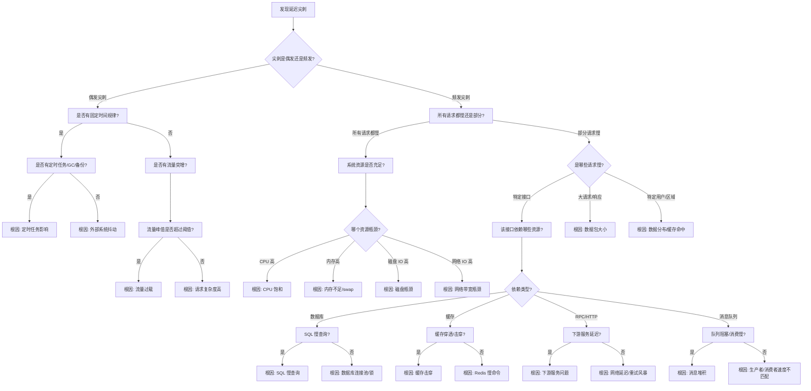

# 延迟尖刺问题诊断决策树

## 延迟尖刺诊断全流程



## 诊断步骤详解

### 第一层：问题定性
**看什么指标？**
- P50、P95、P99 延迟曲线
- 延迟分布直方图
- 错误率、超时率

**用什么工具？**
- Grafana/Prometheus 延迟监控
- 链路追踪系统（Jaeger、Zipkin）
- 日志系统（ELK）
- `curl -w "@curl-format.txt"` - 单请求时延分解

**怎么判断？**
- P99 尖刺但 P50 正常：尾部延迟问题
- 所有百分位都高：系统性问题
- 特定时间段尖刺：定时任务/调度问题

---

### 第二层：请求分类
**看什么指标？**
- 按接口、HTTP method、状态码分组的延迟
- 按用户、租户、区域分组的延迟
- 请求大小与延迟的关系

**用什么工具？**
```bash
# 链路追踪 UI - 查看慢请求 trace
# 日志 - 搜索慢请求日志
# go tool trace - 分析程序执行轨迹
go tool trace http://localhost:6060/debug/pprof/trace?seconds=30
```

**怎么判断？**
- 单接口延迟高：接口内部问题
- 大请求延迟高：数据包/序列化问题
- 特定用户延迟高：数据热点/缓存穿透

---

### 第三层：时延分解
**看什么指标？**
- DNS 时间、TCP 连接时间、TLS 握手时间
- 服务端处理时间、响应传输时间
- 调用链各阶段耗时

**用什么工具？**
```bash
# curl 时延分解
curl -w "
DNS: %{time_namelookup}s
Connect: %{time_connect}s
TLS: %{time_appconnect}s
TTFB: %{time_starttransfer}s
Total: %{time_total}s
" -o /dev/null -s "http://example.com"
```

---

## 根因定位 & 常见解决方案

| 根因分类 | 典型特征 | 检测方法 | 解决方案 |
|---------|---------|---------|---------|
| **CPU 饱和** | CPU 使用率 > 80%<br>延迟与 CPU 正相关 | `top`、pprof CPU profile | 1. 扩容<br>2. 算法优化<br>3. 限流降级 |
| **GC STW** | 尖刺与 GC 周期重合<br>go_gc_duration_seconds 高 | `GODEBUG=gctrace=1` 看 GC 日志 | 1. 减少对象分配<br>2. 调大 GOGC<br>3. 调整 GC 频率 |
| **SQL 慢查询** | 数据库 CPU/IO 高<br>慢查询日志有记录 | 数据库慢查询日志<br>EXPLAIN 分析 SQL | 1. 添加索引<br>2. 优化 SQL<br>3. 读写分离<br>4. 增加缓存 |
| **缓存击穿** | 热点 key 过期时尖刺<br>数据库流量突增 | Redis 慢日志<br>缓存命中率监控 | 1. 热点 key 永不过期<br>2. 互斥锁重建<br>3. 预热热点数据 |
| **下游服务慢** | 调用链显示 RPC 占比高<br>下游服务延迟高 | 链路追踪<br>下游服务监控 | 1. 异步调用<br>2. 熔断降级<br>3. 增加缓存<br>4. 下游优化 |
| **网络延迟** | TCP 重传率高<br>跨机房调用延迟高 | `ping`、`traceroute`<br>tcpdump 抓包 | 1. 同机房部署<br>2. 连接池复用<br>3. 批量请求<br>4. 压缩传输 |
| **锁竞争** | trace 中 sync.Mutex 占比高<br>goroutine 阻塞在锁 | mutex profile<br>go tool trace | 1. 减小锁粒度<br>2. 读写分离锁<br>3. 原子操作<br>4. 无锁数据结构 |
| **连接池耗尽** | 请求等待连接时间长<br>连接数达到上限 | 连接池指标<br>net/http pprof | 1. 调大连接池<br>2. 缩短空闲超时<br>3. 限流 |
| **重试风暴** | 重试次数激增<br>放大效应明显 | 重试指标<br>错误率监控 | 1. 退避指数<br>2. 重试次数上限<br>3. 熔断保护<br>4. 幂等保证 |
| **消息堆积** | MQ 消息数持续增长<br>消费延迟越来越大 | MQ 监控<br>消费速度监控 | 1. 扩容消费者<br>2. 批量消费<br>3. 优化消费逻辑 |

## 延迟尖刺常见模式

### 1. GC STW 尖刺
```go
// ❌ 问题：每次请求都分配大量对象，触发频繁 GC
func handleRequest(w http.ResponseWriter, r *http.Request) {
    // 每次请求都创建大对象
    data := make([]byte, 1024*1024) // 1MB
    // ... 使用 data
}

// ✅ 优化：使用对象池
var pool = sync.Pool{
    New: func() interface{} {
        return make([]byte, 1024*1024)
    },
}

func handleRequest(w http.ResponseWriter, r *http.Request) {
    data := pool.Get().([]byte)
    defer pool.Put(data)
    // ... 使用 data
}
```

### 2. 数据库连接池耗尽
```go
// ❌ 问题：连接池太小，高并发时等待连接
db.SetMaxOpenConns(10) // 太小

// ✅ 优化：合理配置连接池
db.SetMaxOpenConns(100)
db.SetMaxIdleConns(50)
db.SetConnMaxLifetime(time.Hour)
db.SetConnMaxIdleTime(10 * time.Minute)
```

### 3. 缓存击穿
```go
// ❌ 问题：热点 key 过期，大量请求打到数据库
func GetData(key string) (*Data, error) {
    data, err := cache.Get(key)
    if err == redis.Nil {
        // 缓存未命中，查数据库
        return db.Query(key) // 大量并发请求打到 DB
    }
    return data, nil
}

// ✅ 优化：单飞模式 (singleflight)
var group singleflight.Group

func GetData(key string) (*Data, error) {
    result, err, _ := group.Do(key, func() (interface{}, error) {
        data, err := cache.Get(key)
        if err == redis.Nil {
            data, err = db.Query(key)
            if err == nil {
                cache.Set(key, data, time.Minute)
            }
        }
        return data, err
    })
    return result.(*Data), err
}
```

## 快速检查清单

1. ✅ 看 P50/P95/P99 延迟曲线，确定尖刺模式
2. ✅ 检查同期 CPU、内存、IO、网络指标
3. ✅ 检查 GC 指标（go_gc_duration_seconds、go_gc_cycles）
4. ✅ 查看链路追踪，找慢请求的耗时分布
5. ✅ 检查数据库慢查询日志、Redis 慢日志
6. ✅ 检查下游服务延迟、错误率
7. ✅ `go tool trace` 分析调度、GC、锁竞争
8. ✅ 检查连接池、goroutine 数量指标
9. ✅ 检查是否有重试、超时配置问题
10. ✅ tcpdump 抓包看网络延迟
