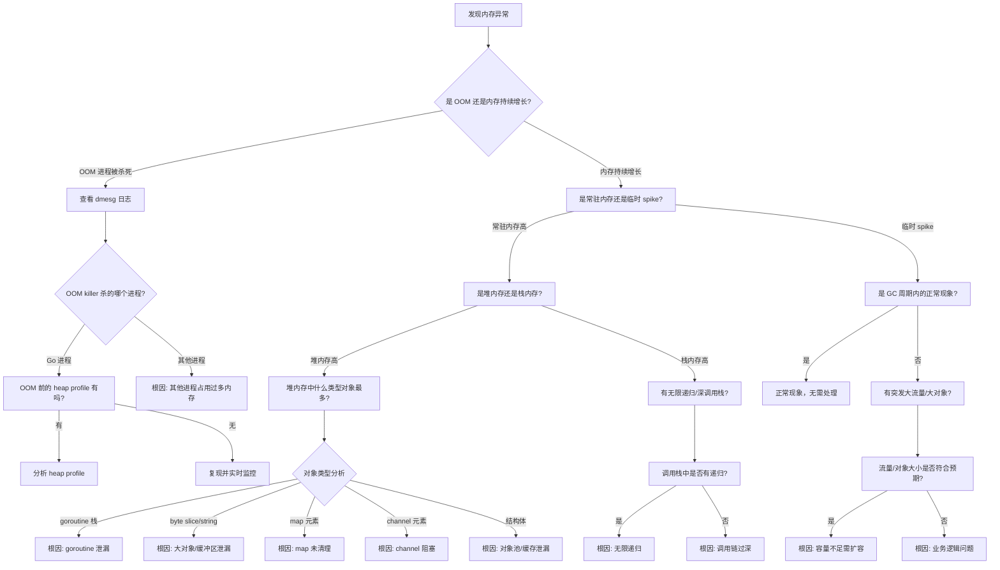

# 内存泄漏/OOM 问题诊断决策树

## 内存泄漏/OOM 诊断全流程



## 诊断步骤详解

### 第一层：问题定性
**看什么指标？**
- 内存使用率趋势（RSS、VIRT）
- 进程内存 vs 系统内存
- 是否有 OOM kill 日志

**用什么工具？**
- `dmesg | grep -i oom` - 查看 OOM 日志
- `free -h` - 系统整体内存
- `top` / `htop` - 进程内存（RES 列）
- Grafana/Prometheus 内存监控

**怎么判断？**
- RES 持续增长不下降：内存泄漏
- 突然 OOM kill：大对象/突发流量
- 系统内存耗尽：可能是其他进程问题

---

### 第二层：Go 内存分布
**看什么指标？**
- HeapAlloc、HeapInuse、HeapIdle
- StackInuse、MSpanInuse、MCacheInuse
- Goroutine 数量

**用什么工具？**
```bash
# 实时查看 Go runtime 指标
curl http://localhost:6060/debug/pprof/heap?debug=1

# 采样 heap profile
go tool pprof -http=:8080 http://localhost:6060/debug/pprof/heap

# 对比两个时间点的 heap profile
go tool pprof -base heap_before.pprof heap_after.pprof
```

**怎么判断？**
- HeapAlloc >> HeapInuse：大量对象等待 GC
- HeapInuse 持续增长：内存泄漏
- Goroutine 数量异常高：goroutine 泄漏

---

### 第三层：定位泄漏源
**看什么指标？**
- 哪类对象占用内存最多
- 哪个函数分配的对象最多
- 对象引用链

**用什么工具？**
```bash
# heap profile 分析
top10 -inuse_space  - 查看占用内存最多的函数
top10 -alloc_space  - 查看分配内存最多的函数
list <函数名>       - 查看函数内哪行代码分配多

# 查看 goroutine
go tool pprof http://localhost:6060/debug/pprof/goroutine
goroutine -sort=delay - 查看阻塞时间最长的 goroutine
```

---

## 根因定位 & 常见解决方案

| 根因分类 | 典型特征 | 检测方法 | 解决方案 |
|---------|---------|---------|---------|
| **goroutine 泄漏** | goroutine 数量持续增长<br>heap 中 runtime.g 占比高 | `curl /debug/pprof/goroutine?debug=2` | 1. 检查 channel 是否阻塞<br>2. 检查 context 是否取消<br>3. 检查 sync.WaitGroup 误用<br>4. 检查定时器泄漏 |
| **大对象泄漏** | heap 中 byte slice 占比高<br>内存增长与请求量正相关 | `list` 看哪个函数分配大 slice | 1. 使用对象池<br>2. 避免全局变量持有<br>3. 控制缓冲区大小<br>4. 及时重置 slice |
| **map 泄漏** | map 持续写入但不删除<br>map key 类型是指针/字符串 | `heap profile` 看 map 相关 | 1. 定期清理过期 key<br>2. 使用 LRU 缓存<br>3. 设置 map 容量上限 |
| **channel 泄漏** | goroutine 阻塞在 channel 操作<br>channel 没有 close | goroutine profile 看 chanXXX | 1. 避免无缓冲 channel 阻塞<br>2. 使用 select + timeout<br>3. 确保 sender 关闭 channel |
| **定时器泄漏** | time.Ticker 未 Stop<br>time.After 在循环中使用 | goroutine profile 看 timer | 1. 必须 Stop Ticker<br>2. 循环外创建定时器<br>3. 使用 context 取消 |
| **对象池泄漏** | sync.Pool 持有过多对象<br>池对象引用了外部资源 | heap profile 看 pool | 1. 控制池大小<br>2. 归还对象前清理引用<br>3. 避免池对象持有大内存 |
| **闭包引用** | goroutine 闭包捕获外部变量<br>循环变量捕获问题 | 分析 goroutine 调用栈 | 1. 循环中避免捕获变量<br>2. 显式传参<br>3. 及时释放闭包引用 |
| **无限递归** | stack 内存持续增长<br>栈溢出 panic | panic 栈信息 | 1. 增加递归终止条件<br>2. 改为迭代实现<br>3. 增加递归深度检查 |

## 内存泄漏常见模式

### 1. Goroutine 泄漏模式
```go
// ❌ 错误：channel 阻塞导致 goroutine 永远挂起
func leak() {
    ch := make(chan int)
    go func() {
        val := <-ch // 永远等不到数据
        fmt.Println(val)
    }()
    // 忘记向 ch 发送数据或关闭
}

// ✅ 正确：使用 select + timeout
func noLeak() {
    ch := make(chan int)
    go func() {
        select {
        case val := <-ch:
            fmt.Println(val)
        case <-time.After(5 * time.Second):
            return
        }
    }()
}
```

### 2. Map 泄漏模式
```go
// ❌ 错误：只加不删，map 无限增长
var cache = make(map[string]*BigObject)

func addToCache(key string, obj *BigObject) {
    cache[key] = obj // 永远不删除
}

// ✅ 正确：带过期时间的 LRU 缓存
func addToCache(key string, obj *BigObject) {
    if len(cache) >= MAX_SIZE {
        evictOldest() // 淘汰策略
    }
    cache[key] = obj
}
```

## 快速检查清单

1. ✅ `dmesg` 确认是否 OOM kill
2. ✅ `top` 确认哪个进程内存高
3. ✅ `curl /debug/pprof/heap?debug=1` 看 Go 内存分布
4. ✅ `curl /debug/pprof/goroutine?debug=1` 看 goroutine 数量
5. ✅ 采样 heap profile，对比前后差异
6. ✅ `top10 -inuse_space` 找内存大户
7. ✅ `list` 定位到具体代码行
8. ✅ 检查是否有 channel 阻塞、map 无限增长、定时器未 Stop
